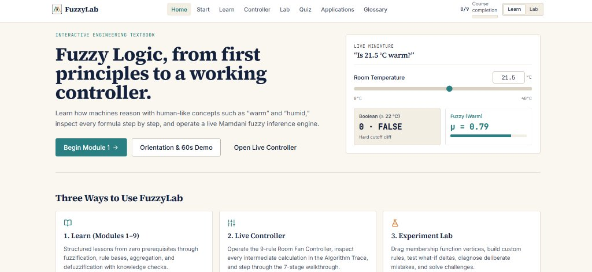

# FuzzyLab – Interactive Fuzzy Logic Learning Platform

**LIVE DEMO:** [https://softcomputingassignment.vercel.app/](https://softcomputingassignment.vercel.app/)

**GITHUB:** [https://github.com/AGASTYA12343534/softcomputingassignment](https://github.com/AGASTYA12343534/softcomputingassignment)

---

FuzzyLab is an interactive, university-level educational web application designed to teach **Fuzzy Logic** from first principles to a complete working **Mamdani Fuzzy Logic Controller**. Every membership degree, rule firing strength, clipped consequent, aggregated envelope, and defuzzified output is computed live in the browser by a pure TypeScript inference engine with zero hardcoded results.



---

## Key Features

- **Editorial Textbook Experience**: Clean, distraction-free typography (`Source Serif 4`, `Inter`, `JetBrains Mono`) with KaTeX mathematical rendering and a clickable **Formula Explorer** that explains every symbol in context.
- **9 Structured Learning Modules**: Guided progression from binary vs. fuzzy concepts through membership functions, fuzzification, rule bases, implication, aggregation, defuzzification, and full controller assembly.
- **Live Mamdani Controller (`/controller`)**: Real-time 2-input, 9-rule Room Fan Controller with scenario presets, `Minimum` / `Product` AND operator toggle, Centroid / Bisector / Mean of Maxima comparison, and a JSON-exportable **Algorithm Trace Inspector**.
- **7-Stage Step-by-Step Walkthrough**: Interactive state-machine simulation with Play/Pause/Prev/Next/Reset controls, playback speed adjustment, and keyboard shortcuts (`Space`, `←`, `→`, `R`).
- **Experiment Lab (`/lab`)**: Dark-panel control deck with Beginner and Advanced settings, interactive **Membership Function Playground** (mouse, touch, and arrow-key dragging with validation), **Visual Rule Builder**, **What-If Simulator**, **Mistake Explorer**, **Challenge Mode**, and `localStorage`/JSON export & import.
- **Quiz & Final Assessment (`/quiz`, `/quiz/final`, `/quiz/challenge`)**: 32-question practice bank with per-option wrong-answer explanations, numeric tolerance grading, and a 20-question Final Assessment with per-module breakdown.
- **Real-World Applications & Glossary (`/applications`, `/glossary`)**: Six engine-powered teaching models (room temperature, washing machine, inverter AC, automotive braking, loan risk, industrial boiler) plus a searchable glossary and print-friendly Formula Cheat Sheet.

---

## Learning Modules

| Module | Topic | Key Concepts Covered |
| :--- | :--- | :--- |
| **Module 1** | Introduction to Fuzzy Logic | Vagueness vs. hard thresholds, continuous `[0, 1]` membership |
| **Module 2** | Boolean Logic vs. Fuzzy Logic | `{0, 1}` vs. `[0, 1]`, fuzzy membership vs. statistical probability |
| **Module 3** | Fuzzy Sets & Membership Functions | Universe of discourse, triangular, trapezoidal (shoulders), Gaussian |
| **Module 4** | Fuzzification | Evaluating crisp inputs across overlapping sets with exact branches |
| **Module 5** | Fuzzy Rule Base | `IF–THEN` rules, antecedents, consequents, `AND` / `OR` operators |
| **Module 6** | Inference Engine | Firing strengths (`min` vs. `product`), Mamdani minimum clipping |
| **Module 7** | Aggregation | Pointwise `max` envelope across clipped rule consequents |
| **Module 8** | Defuzzification | Centroid of Area, Bisector of Area, Mean of Maxima |
| **Module 9** | Complete Fuzzy Logic Controller | End-to-end Room Fan Controller & hand-verified reference case |

---

## Interactive Fuzzy Logic Controller

The flagship **Room Fan Controller** maps two crisp inputs—**Temperature** `[0, 40] °C` and **Humidity** `[0, 100] %`—to **Fan Speed** `[0, 100] %` using three linguistic sets per variable and a complete 9-rule Mamdani rule base (`R1`–`R9`).

### Hand-Verifiable Reference Case (`24 °C`, `45 %`)
- **Fuzzification**: `Warm = 1.0` (`Cool = 0`, `Hot = 0`); `Dry = 0.2`, `Normal = 0.8` (`Humid = 0`)
- **Active Rules**: `R4` (Warm & Dry → Low) = `0.2`, `R5` (Warm & Normal → Medium) = `0.8`
- **Discrete Centroid (`0..100` integer grid)**: `1493.1667 / 33.5` = **`44.57%`**
- **Continuous Analytic Centroid (100,000-sample integral)**: `1493.2 / 33.4` = **`44.707%`**
- **Mean of Maxima (MoM)**: **`50.00%`**

---

## Technologies Used

- **Frontend**: React 18, TypeScript (strict mode), Vite, Tailwind CSS, React Router v6
- **State & Motion**: Zustand, Framer Motion (respecting `prefers-reduced-motion`)
- **Math, Icons & Fonts**: KaTeX, Lucide React, Fontsource (`Source Serif 4`, `Inter`, `JetBrains Mono`)
- **Testing & Tooling**: Vitest, React Testing Library, ESLint, Prettier, Vercel SPA deployment

---

## Installation & Setup Instructions

### Prerequisites
- **Node.js** `v20+` (developed and verified on `v22.20.0`)
- **npm** `10+`

### Clone & Install

```bash
git clone https://github.com/AGASTYA12343534/softcomputingassignment.git
cd softcomputingassignment
npm install
```

---

## How to Run Locally

```bash
# Start the development server
npm run dev

# Run all unit, quiz-verification, and integration tests
npm test

# Typecheck and lint
npm run typecheck
npm run lint

# Build for production and preview locally
npm run build
npm run preview
```

---

## Project Structure

```text
src/
  engine/          Pure TypeScript Mamdani fuzzy inference library (zero React imports)
  content/         Curriculum modules (1–9), formula symbol dictionary, glossary, applications
  quiz/            32-question bank, seeded shuffle, and tolerance-aware grading
  state/           Zustand stores (progress, walkthrough simulation, experiment lab)
  components/      Design-system UI primitives, custom SVG charts, controller, walkthrough, lab tools
  pages/           Lazy-loaded route pages
tests/
  engine/          Independent brute-force reference, membership, and controller tests
  quiz/            Question bank & engine-verified calculation key tests
  e2e/             React Testing Library route & controller integration smoke tests
docs/
  ENVIRONMENT.md   Toolchain & environment notes
  DECISIONS.md     Mathematical & architectural decisions
  VALIDATION.md    Hand-calculation vs. engine validation tables
  screenshots/     Live deployment preview screenshots
```

---

## Mathematical Validation and Testing

All inference calculations are validated against an independent brute-force reference implementation in `tests/engine/referenceImpl.ts` and verified with `npm test`:

- **4 test files / 23 tests passing** (`tests/engine/membership.test.ts`, `tests/engine/controller.test.ts`, `tests/quiz/quiz.test.ts`, `tests/e2e/app.test.tsx`).
- Verified properties include left/right trapezoidal shoulder handling (`Cool(0) = 1`, `Hot(40) = 1`), partition-of-unity checks, `Low ↔ High` mirror symmetry, corner cases, `min` vs. `product` operator divergence, monotonicity, zero-area `{ ok: false }` edge-case safety, and automated verification of every numeric quiz answer key against the engine.
- Detailed validation tables are available in [docs/VALIDATION.md](docs/VALIDATION.md).

---

## Author Information

- **Author**: Agastya (`AGASTYA12343534`)
- **Email**: agastyaindian2005@gmail.com
- **GitHub**: [https://github.com/AGASTYA12343534/softcomputingassignment](https://github.com/AGASTYA12343534/softcomputingassignment)
- **Live Demo**: [https://softcomputingassignment.vercel.app/](https://softcomputingassignment.vercel.app/)
